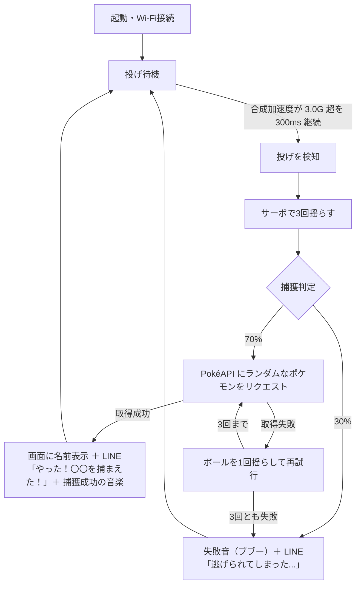

# DXモンスターボール

> An IoT toy ball that lets you "catch" a Pokémon just by throwing it.

**投げると、ポケモンが捕まえられる。** M5StickC を仕込んだボールを投げると、ボールがカタカタと3回揺れ、運が良ければランダムなポケモンをゲットできる IoT おもちゃです。

📄 作品ページ（ProtoPedia）: https://protopedia.net/prototype/5705

---

## What

「アニメのように、投げたボールでポケモンを捕まえてみたい」を形にした作品です。

- ボールの中の **M5StickC** が加速度センサーで「投げた」ことを検知
- **サーボモーター** でボールを3回揺らし、捕獲直後のあの「3回の揺れ」を再現
- 捕獲に成功すると **PokéAPI** からランダムにポケモンを呼び出し、画面表示・LINE通知・ファンファーレでお知らせ
- 失敗すると「ブブー」という音とともに「逃げられてしまった…」

広島工業大学 情報学部 情報コミュニケーション学科3年の講義「アプリケーションデザインB」のグループ最終課題として、「どうせ作るなら面白いものを作ろう」という発想から生まれました。

## 遊び方

1. 電源を入れると Wi-Fi に接続し、画面に「投げ待機中...」と表示されます。
2. ボールを投げます。
3. ボールが3回揺れます（ドキドキの時間）。
4. 結果発表
   - **成功（70%）**: ポケモンの名前が画面に表示され、LINE に「やった！〇〇を捕まえた！」と届き、捕獲成功の音楽が流れます。
   - **失敗（30%）**: 「ブブー」という音とともに、LINE に「逃げられてしまった...」と届きます。
5. 待機状態に戻るので、また投げられます。

## 仕組み

ポイント:

- **投擲検知**: 内蔵 IMU の加速度 3 軸から合成加速度を計算し、しきい値 `THROW_THRESHOLD = 3.0` を `DETECTION_DURATION = 300`（ms）以上超え続けたら「投げた」と判定します。
- **捕獲判定**: `random(100) < 70` で 70% の確率で成功。
- **ポケモンの取得**: 図鑑番号 1〜898 からランダムに選び、PokéAPI の `pokemon` → `pokemon-species` を順に呼んで日本語名を取得します（日本語名が見つからない場合は英語名）。
- **リトライ演出**: PokéAPI の応答が不安定なため、取得に失敗するとボールを1回揺らして再試行します（最大3回）。3回とも失敗した場合は「逃げられた」扱いになります。

## ハードウェア構成

| パーツ | 用途 | 接続 |
| --- | --- | --- |
| M5StickC | 本体（ESP32・加速度センサー・画面・Wi-Fi） | — |
| サーボモーター | ボールを揺らす | G26（`servoPin`） |
| スピーカー | 成功音楽・失敗音 | G0（`spPin`） |

M5StickC と追加パーツをボールの中に入れて使います。

## 技術スタック

| 分類 | 使用技術 |
| --- | --- |
| マイコン | M5StickC |
| 開発環境 | Arduino IDE 2.3.3 |
| 外部 API | [PokéAPI](https://pokeapi.co/)、LINE Notify（※サービス終了） |
| 通信 | Wi-Fi（HTTPClient） |

### ライブラリ

| ライブラリ | 作者 | バージョン |
| --- | --- | --- |
| M5Unified | M5Stack | 0.1.16 |
| M5GFX | M5Stack | 0.1.16（M5Unified の依存） |
| ServoESP32 | Jaroslav Paral | 1.0.3 |
| ArduinoJson | Benoit Blanchon | 7.0.4 |

## セットアップ

### 1. Arduino IDE の準備

1. [Arduino IDE](https://www.arduino.cc/en/software)（開発時は 2.3.3）をインストールします。
2. ボードマネージャで M5StickC 用のボードパッケージを導入し、ボードに M5StickC を選択します。
   - コードは `ledcSetup()` / `ledcAttachPin()` を使っています。これらは ESP32 Arduino core 3.x 系で廃止された API のため、**core 2.x 系ベースのボードパッケージ** を使ってください。
3. ライブラリマネージャで上記のライブラリ4つを、表のバージョンでインストールします。

### 2. スケッチを開く

スケッチ本体は `main.iso` です（中身は Arduino スケッチ）。Arduino IDE で新規スケッチを作成し、`main.iso` の内容を貼り付けて保存してください。

### 3. 設定値を書き換える

`main.iso` 冒頭の以下の変数を自分の環境に合わせて書き換えます。

| 変数 | 内容 | 初期値 |
| --- | --- | --- |
| `ssid` | Wi-Fi の SSID | `"WIFI名"` |
| `password` | Wi-Fi のパスワード | `"WIFIパスワード"` |
| `lineNotifyToken` | LINE Notify のアクセストークン | `"LINE Notifyトークン"` |

必要に応じて、以下も調整できます。

| 変数 | 内容 | 初期値 |
| --- | --- | --- |
| `THROW_THRESHOLD` | 投げ判定の加速度しきい値 | `3.0` |
| `DETECTION_DURATION` | しきい値を超え続ける必要がある時間（ms） | `300` |
| `servoPin` | サーボの接続ピン | `26` |
| `spPin` | スピーカーの接続ピン | `0` |

> ⚠️ LINE Notify は 2025年3月にサービスを終了しているため、トークンの新規発行はできません（下記「注意事項」参照）。

### 4. 書き込み

M5StickC を USB で接続し、シリアルポートを選んで書き込みます。起動後に画面へ「WiFi接続完了」「投げ待機中...」と表示されれば準備完了です。

## チームと役割

3名のチームで開発しました。開発期間は約2週間（2024年7月）。

| メンバー | 担当 |
| --- | --- |
| Tanasuke（[@nekopath-dev](https://github.com/nekopath-dev)） | プログラム全般 |
| チームメンバー 2名 | 発表資料・動作テストなど、プログラム以外 |

企画はメンバー全員で考案しました。

## 開発秘話

### 苦労したこと

音楽とモーターを同時に動かすと不具合が起きる問題に悩まされました。コードをコメントアウトしながら原因箇所を切り分け、最終的には生成AIの力も借りて修正しました（根本原因までは特定できていません）。

### 学んだこと

この経験から、「一人で悩むよりチームに頼ったほうが早い、そして楽しい」ということを学びました。

### 反響

アルバイト先の仲間に試してもらったところ、「伝説のポケモンが出るまでやる！」と夢中になって何度も投げてくれました。

## 受賞・出品

- 🏆 講義「アプリケーションデザインB」 作品最優秀賞
- 📮 [M5Stack Japan Creativity Contest 2024](https://www.switch-science.com/pages/m5stack-japan-creativity-contest-2024)（スイッチサイエンス主催）出品

## 注意事項・免責

- **LINE Notify のサービス終了について**: LINE Notify は 2025年3月にサービスを終了したため、LINE 通知の部分は現在動作しません。
- 本作品は個人（学生チーム）による **非公式のファン作品** です。株式会社ポケモン、任天堂、株式会社クリーチャーズ、株式会社ゲームフリークとは一切関係ありません。
- 「ポケモン」「Pokémon」「モンスターボール」は任天堂・クリーチャーズ・ゲームフリーク／株式会社ポケモンの商標または登録商標です。
- ポケモンのデータは [PokéAPI](https://pokeapi.co/) から取得しています。

## 作者

Tanasuke — [@nekopath-dev](https://github.com/nekopath-dev)
